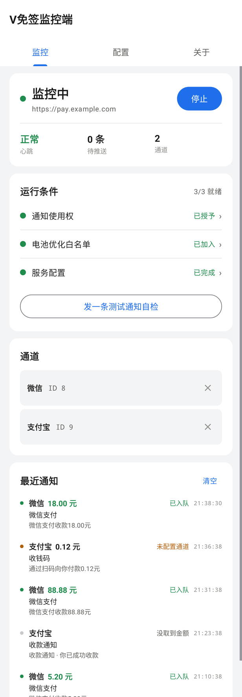
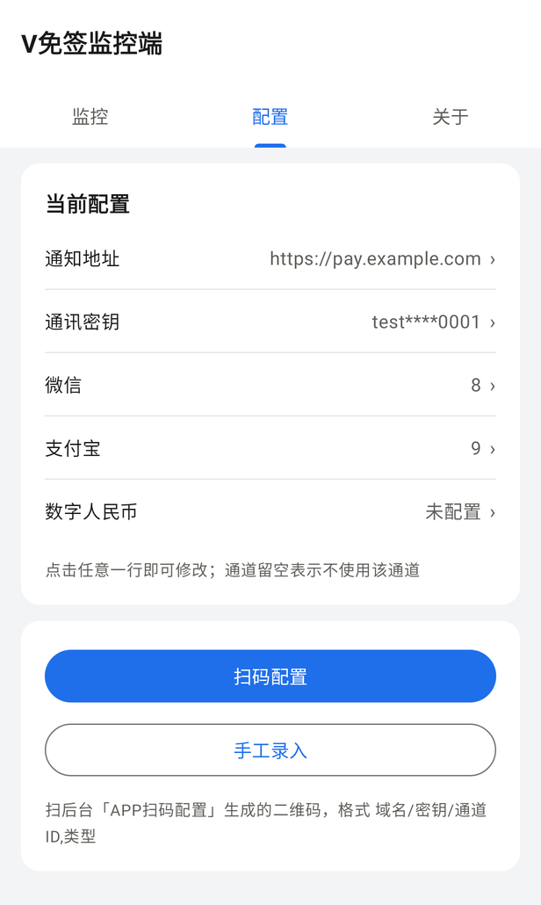
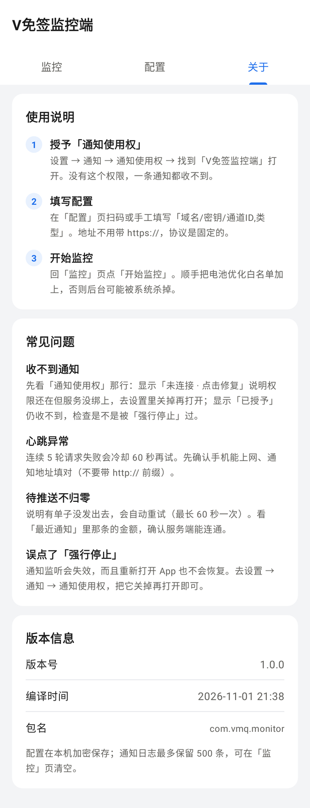

# vmq-monitor-android

V免签（vmq）收款监控端的 Android 原生实现。

监听通知栏的到账通知 → 按规则识别平台与金额 → 上报到你的服务端。
协议与 V免签后台兼容，扫同一个配置二维码即可。

- 本仓库只含客户端，服务端需自行部署
- `minSdk 24`（Android 7.0+）/ `targetSdk 34`

---

## 一、快速开始

用 **Android Studio**（Hedgehog 或更新）打开本目录即可，Gradle wrapper 会自动下载
Gradle 8.2 与依赖。

```bash
./gradlew assembleDebug          # 产物在 app/build/outputs/apk/debug/
./gradlew testDebugUnitTest      # 单元测试
./gradlew assembleRelease        # release 包（未签名，见下）
adb install -r app/build/outputs/apk/debug/app-debug.apk
```

- Kotlin 1.9.24 / AGP 8.2.2 / JDK 17 / `compileSdk 34`
- 包名 `com.vmq.monitor`
- 命令行构建需要 Android SDK：设 `ANDROID_HOME`，或在 `local.properties` 写
  `sdk.dir=/path/to/Android/sdk`（该文件已列入 `.gitignore`，Android Studio 首次打开会自动生成）

首次安装后必须做两件事：

1. **授予「通知使用权」**：设置 → 通知 → 通知使用权 → 找到「V免签监控端」打开
   （App 里点这个权限项会直接跳转）
2. **加入电池优化白名单**：设置 → 电池 → 无限制；或点 App 里的对应项

### 签名（发布 release 包时）

`assembleRelease` 产出未签名包，只能侧载测试。正式发布先生成密钥库：

```bash
keytool -genkey -v -keystore vmq-release.jks -keyalg RSA -keysize 2048 \
        -validity 10000 -alias vmq
```

再在 `app/build.gradle.kts` 的 `android {}` 里加（密码走环境变量，不要提交）：

```kotlin
signingConfigs {
    create("release") {
        storeFile = file("vmq-release.jks")
        storePassword = System.getenv("VMQ_STORE_PASS")
        keyAlias = "vmq"
        keyPassword = System.getenv("VMQ_KEY_PASS")
    }
}
buildTypes { release { signingConfig = signingConfigs.getByName("release") } }
```

---

## 二、界面

三个面板，从上到下回答四个问题：**在跑吗 → 卡在哪 → 配了哪些 → 刚才那条为什么没推出去**。

<p align="center">
  
  
  
</p>

> 截图由 `ScreenshotTest` 用 Robolectric 渲染生成（`./gradlew testDebugUnitTest`），
> 数据全部是假的：域名 `pay.example.com`、密钥 `testkey0001`、通道 8/9。

### 监控面板

| 区块 | 内容 |
|---|---|
| 状态总览 | 状态点 + 运行状态 + 当前地址；右侧是唯一的开关。下方三个指标：心跳 / 待推送 / 通道 |
| 运行条件 | 通知使用权、电池白名单、服务配置三项是否就绪，右上角汇总 `N/3`。**点哪行去哪个地方修** |
| 通道 | 已配置的通道（类型 + ID），点 ✕ 移除，弹二次确认 |
| 最近通知 | 最近 20 条，左侧圆点标处理结果：绿=已入队 / 橙=未配通道 / 红=没取到金额 / 灰=未匹配 |

### 配置面板

顶部是「通知地址 / 通讯密钥 / 微信通道 ID / 支付宝通道 ID / 数字人民币通道 ID」，
**点哪行改哪行**，密钥打码显示。下面是扫码配置与手工录入两个入口。

### 关于面板

使用说明、常见问题、版本信息（版本号 + 编译时间，取自 `BuildConfig`）。

### 扫码页

竖屏，顶部「← / 扫码 / 相册」，底部手电筒。相册走 `GetContent`，不申请存储权限。

扫码、相册、手工录入三种入口共用同一套解析（`util/QrConfig.kt`），
格式 `域名/密钥/通道ID,类型`，会剥掉手输地址的协议前缀与尾部斜杠。

---

## 三、关键设计

### 协议固定 HTTPS

地址只存 `host`，`baseUrl` 恒为 `https://$host`，**没有开关能降级成明文**。
`network_security_config` 里 `cleartextTrafficPermitted="false"`，且不写任何
`domain-config` 例外 —— 密钥、金额、时间戳不该走明文。要连内网 HTTP 服务，
请给服务端加 TLS。

### 心跳：失败不停止

30 秒一轮，一轮 = 所有通道各发一次，**任意通道成功即算这轮成功**。
失败不终止定时器；连续 5 轮全失败进入 60 秒冷却，之后继续。

失败计数只有一份，存在 `monitor_state.heart_fail`，进程重启天然一致。
按「轮」而不是按「通道」计数，避免多通道时一轮失败被记成多次。

### 推送：失败不丢单

到账推送失败后落 `pending_push` 表，按指数退避重试
（1s → 2s → 4s → 8s → 16s → 32s → 60s 封顶），进程被杀也不丢。

「下次可重试时刻」存在 `next_at` 列上，每轮只取到期的条目 ——
一条卡住的记录不会把后面新到的到账堵住。`onUpgrade` 用增量 `ALTER TABLE`，
不会 DROP 表。

队列轮询是自适应的：空队列 30 秒一次，刚处理过一批 2 秒一次。

### 金额提取

优先匹配两位小数、取**第一个**命中、并做 `0.01–100000` 区间校验。
「收款 18.01 元，余额 1234.56 元」这种文案要取前者。

### 去重

5 秒窗口内，按「窗口内出现过的所有 key」判定，不是只记最后一条 ——
否则 `A → B → A` 这种交错场景第二个 A 会漏判（`monitor/NoticeDeduper.kt`）。

### 后台存活

`MonitorService` 是前台服务（`dataSync` 类型）+ `PARTIAL_WAKE_LOCK`，
驱动心跳与重试队列；`BootReceiver` 在开机和覆盖安装后自动拉起。

`PARTIAL_WAKE_LOCK` 无超时 —— 息屏后 CPU 不被挂起，代价是持续耗电。
想更省电可以改成只在有心跳/推送任务时持锁。

### 配置加密

通讯密钥用 AES-GCM 加密后存 SharedPreferences，密钥由 PBKDF2-SHA256
（120,000 次迭代 + 随机盐）从固定口令派生。

> 这一层防的是 adb backup、文件管理器直接看到明文这类轻量场景，
> **不是端上可信计算** —— 口令写在客户端，root 设备总能提取。
> 要更强的保护得上 Keystore + 生物识别，或把密钥托管到服务端。

派生结果在进程内缓存，只在配置变更时失效。PBKDF2 是刻意设计成慢的，
放进 getter 会让「读一个配置项」变成几百毫秒。

---

## 四、权限

| 权限 | 用途 |
|---|---|
| `INTERNET` | 心跳 / 到账推送 |
| `FOREGROUND_SERVICE` | 前台服务（心跳与重试队列的载体） |
| `FOREGROUND_SERVICE_DATA_SYNC` | API 34 要求：`dataSync` 类型前台服务必须单独声明 |
| `WAKE_LOCK` | `PARTIAL_WAKE_LOCK`，息屏后 CPU 不被挂起 |
| `RECEIVE_BOOT_COMPLETED` | 开机 / 覆盖安装后自动恢复监控 |
| `REQUEST_IGNORE_BATTERY_OPTIMIZATIONS` | 拉起电池白名单申请弹窗 |
| `CAMERA` | 相机扫码（相册识码走 `GetContent`，不需要存储权限） |
| `POST_NOTIFICATIONS` | Android 13+ 发常驻通知与自检通知 |

「通知使用权」不在表里 —— 它不是 `uses-permission`，而是 `NoticeService` 上的
`android:permission="android.permission.BIND_NOTIFICATION_LISTENER_SERVICE"`，
只能由用户在系统设置里手动授予。

> `aapt2 dump permissions` 还会多一条
> `com.vmq.monitor.DYNAMIC_RECEIVER_NOT_EXPORTED_PERMISSION`，那是 androidx.core
> 在 targetSdk 33+ 自动生成的应用自定义签名权限，不弹窗、不涉及用户授权。

---

## 五、代码结构

```
app/src/main/java/com/vmq/monitor/
├── MainActivity.kt            TabLayout + ViewPager2 三个面板，扫码与权限入口
├── MonitorApp.kt              Application
├── monitor/
│   ├── NoticeService.kt       NotificationListenerService
│   ├── NoticeDeduper.kt       5 秒窗口去重
│   ├── MonitorService.kt      前台服务 + PARTIAL_WAKE_LOCK
│   ├── MonitorEngine.kt       匹配 → 提金额 → 入队 → 写日志
│   ├── Workers.kt             HeartbeatManager + PushWorker
│   ├── Rules.kt               匹配规则表 + 金额提取
│   └── BootReceiver.kt        开机自启
├── net/
│   ├── ApiClient.kt           POST /appHeart /appPush
│   └── Signer.kt              md5 签名
├── data/
│   ├── ConfigStore.kt         配置（密钥加密、host 归一化、固定 https）
│   └── Stores.kt              SQLite：notice_log / pending_push / monitor_state
├── ui/
│   ├── MonitorPanel.kt / ConfigPanel.kt / AboutPanel.kt
│   ├── ScanActivity.kt        扫码页
│   └── LogAdapter.kt / PassageAdapter.kt
└── util/
    ├── QrConfig.kt            二维码内容解析
    ├── QrDecoder.kt           从相册图片解二维码
    └── Notifications.kt       自检通知
```

`tools/gen_icon.py` 生成启动图标（PIL + numpy，含 adaptive icon 的
foreground / background / monochrome 三套，输出到各密度目录）。

---

## 六、已知限制

1. **通知使用权是系统级权限**，不授予就无法工作。App 内会引导跳转，但无法程序化授权。

2. **「强行停止」会让通知监听失效，且重新打开 App 也不恢复。**
   force-stop 会把包置为 stopped 并解绑 `NotificationListenerService`，
   之后启动 Activity 不会触发重绑。恢复方法：设置 → 通知 → 通知使用权 →
   找到本应用 → 关掉再打开（或重启手机）。
   普通覆盖安装**不会**触发这个问题。面板上会显示「未连接 · 点击修复」提示该状态。

3. **各家 ROM 的后台策略不同。** 华为 / 小米 / vivo 等需要在系统设置里额外允许
   自启动、锁定后台。加入电池优化白名单是最基本的一步。

4. **Android 14+ 的 `dataSync` 前台服务类型**已在 manifest 声明；
   如果目标机型更严格，可能需要换成 `specialUse` 并提供说明。

5. **扫码依赖 zxing-android-embedded**，需要 CAMERA 权限；
   不想给相机权限可以只用「手工录入」。

6. 二维码里的域名决定实际连哪个服务端 —— 换了服务端要重新扫码，或在配置面板改地址。

---

## 七、与服务端的约定

| App 侧 | 服务端 | 签名 |
|---|---|---|
| 心跳 | `POST /appHeart?t=&pid=&sign=` | `md5(t + pid + key)` |
| 到账推送 | `POST /appPush?type=&price=&t=&pid=&sign=` | `md5(type + price + t + pid + key)` |
| 配置二维码 | 后台生成 | 内容 `域名/密钥/通道ID,类型` |

`type`：1 微信 / 2 支付宝 / 4 数字人民币。

**`price` 必须按原始字符串发送**（`18.01` 而不是 `18.1`），否则签名对不上。

### 返回码

```json
{"code":0,"msg":"成功"}                 // 成功（含"无匹配订单，已记录"）
{"code":-1,"msg":"签名校验不通过"}       // 失败
```

**`code == 0` 才是成功。** 注意别和 `/admin/*` 那套 `{code:1}` 混淆 ——
`/appHeart`、`/appPush` 用的是 0。`ApiClientTest` 锁住了这个行为。

---

## 八、许可证

[MIT](LICENSE)，版权归 vmq-monitor contributors。

第三方组件：

| 组件 | 协议 |
|---|---|
| AndroidX（core-ktx / appcompat / constraintlayout / viewpager2 / lifecycle） | Apache-2.0 |
| Material Components | Apache-2.0 |
| Kotlin / kotlinx.coroutines | Apache-2.0 |
| zxing-android-embedded / zxing core | Apache-2.0 |
| Robolectric（仅测试） | MIT |
| JUnit 4（仅测试） | EPL-1.0 |

本项目**不收集任何用户数据**：通知内容只在设备本地解析、入队、上报到你自己的服务端，
配置加密存在本机 SharedPreferences，没有第三方统计或崩溃上报 SDK。
